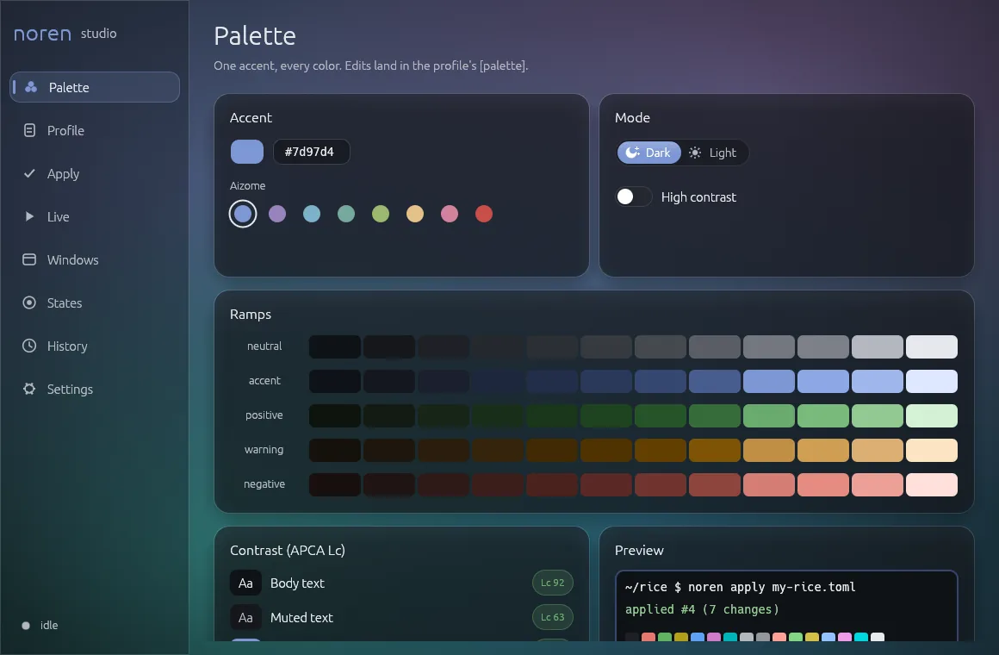
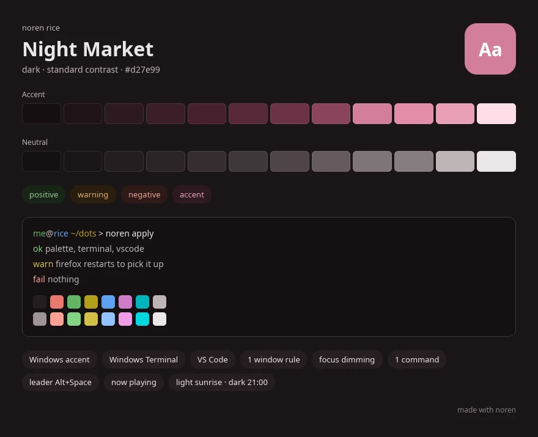
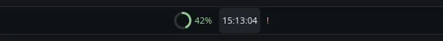
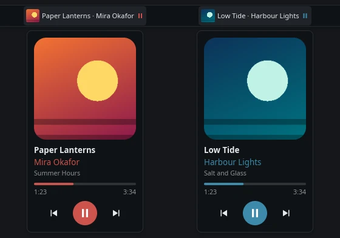

<div align="center">

# noren

**Rice Windows like a Linux desktop, and undo it in one command.**<br>
A pure-Rust framework for panels, desktop widgets, overlays, palettes and transactional theming.

[](LICENSE)
[](#limitations)
[](#building)

English | [Polski](README.pl.md)

</div>

<p align="center"></p>

**noren studio** is where you rice. Pick one accent color and watch it become a full palette with contrast-checked text. See what will change in Windows, Windows Terminal, VS Code and Firefox, apply it as one transaction, and roll it back with one click. Hold window rules, focus dimming, x-ray, chords, hot corners, edge glows and a dark/light schedule live while the studio sits in the tray. The `noren` command line does the same from scripts and CI.

- **A palette from one color.** OKLCH ramps for dark and light mode, with text pushed until it passes APCA contrast.
- **Apply and undo safely.** Every write is journaled with the bytes it replaces. A failed apply reverts itself.
- **Your edits are kept.** JSON configs keep their comments and key order. Rollback leaves alone anything you changed after the apply.
- **Profiles are TOML files.** Keep them in git, diff them, share them.
- **Desktop surfaces.** Panels, widgets and overlays as transparent, click-through windows: on the desktop layer, as an AppBar or above everything.
- **Rust only.** MIT licensed, no webview, no XAML runtime.

## noren studio

| Page | What it does |
|---|---|
| Palette | Accent with Aizome presets, dark or light, high contrast, live ramps, APCA checks, a preview |
| Profile | The profile as TOML, checked as you type |
| Apply | The diff, apply as one transaction, roll back |
| Live | Hold window rules, focus dimming, x-ray, chords, hot corners, edge glows and the dark/light schedule; optionally on start |
| Windows | Every window, and which rules match it |
| States | Set the named states that borders and edge glows follow |
| History | Every apply, newest first |
| Settings | English or Polish, Reduce motion |

```sh
cargo build --release --features studio
noren-studio                 # opens on the Palette page
noren-studio --page live     # palette, profile, apply, live, windows, states, history, settings
```

- Ctrl+K opens the command palette: the profile's commands, page jumps, Save and the live toggle.
- Closing the window hides it to the tray; the live runtime keeps running. Tray menu: Open, Hold profile live, Quit. Quit restores every window and exits.
- Glass panels and eased motion. The default look is Aizome, noren's own indigo palette, and the studio recolors itself from the profile's palette as you edit it.
- Switching between dark and light spreads the new background across the window from the switch, and its moon and sun icons animate.
- On Windows 11 the window gets an acrylic backdrop.
- Settings live in `%LOCALAPPDATA%\noren\studio.json`.
- The CLI does not need the `studio` feature.

## What it customizes

| Target | What changes | Where |
|---|---|---|
| Windows | Accent color, Start and taskbar accent, title bars and borders, light/dark mode | `HKCU` registry, then a `WM_SETTINGCHANGE` broadcast |
| Windows Terminal | Adds a color scheme and makes it the default | `settings.json`, BOM and comments kept |
| VS Code | `workbench.colorCustomizations`, including the terminal ANSI colors | `settings.json`, comments kept |
| Firefox | `userChrome.css`, plus the pref that enables it | A marked `noren:begin` / `noren:end` block |
| Any window | Corners, Mica/acrylic backdrop, border, caption and title colors, dark frame, opacity, monitor | Live DWM attributes, held by noren studio or `noren run` |
| Your own UI | Panels, widgets and overlays built with noren | `Palette::theme()` |

Exports for anything else: `noren palette <#accent> --export terminal|vscode|css|kde|firefox`.

## Quick start

1. Build it (see [Building](#building)):
   ```sh
   cargo build --release --features studio
   ```
2. Run `noren-studio`. On **Palette**, pick an accent; on **Profile**, add the apps to theme (the starter profile has Windows Terminal and VS Code).
3. On **Apply**, read the diff and press Apply. One transaction, journaled.
4. Changed your mind? Roll back on **Apply** puts every byte back. **History** lists every apply.

### From the command line

The same steps, for scripts and CI. `cargo install --path .` puts `noren` on your `PATH`.

1. Preview a palette:
   ```sh
   noren palette '#7d97d4'
   ```
2. Write `my-rice.toml`:
   ```toml
   schema = 1
   name = "my-rice"

   [palette]
   accent = "#7d97d4"
   mode = "dark"            # dark | light
   contrast = "standard"    # standard | high

   [windows]
   accent_on_title_bars = true

   [terminal]
   [vscode]
   ```
3. See what would change, then apply:
   ```sh
   noren diff my-rice.toml
   noren apply my-rice.toml
   ```
4. Undo it:
   ```sh
   noren rollback
   ```

A table you leave out is never touched. Every target takes `path = "..."` to point at a non-default config file. The full format is documented in [src/rice/profile.rs](src/rice/profile.rs).

### Sharing a rice

`noren card` renders a profile to one PNG: name, accent and neutral ramps, the 16 terminal colors on a sample prompt, and what the profile sets up. In noren studio it is **Share card…** on the Profile page.

```sh
noren card my-rice.toml card.png              # 2x by default; --scale 1 for a smaller file
```



### Updates and compatibility reports

`noren update` installs the newest release from GitHub Releases. It updates `noren.exe` and, if it sits next to it, `noren-studio.exe`. Before swapping anything, it checks a minisign signature over `SHA256SUMS`, made with the key built into noren, and checks each download against its sum. `noren update --check` only reports what is available. The studio checks when it opens; you can turn that off in Settings.

`noren report [profile.toml]` prints an opt-in compatibility report: the noren and Windows versions, monitor sizes and scaling, what the profile sets up, and how the last transactions ended. It holds no profile names, paths or program names. `--open`, or the studio's Settings page, opens the report as a prefilled GitHub issue. Nothing is sent until you submit it.

## Window rules

`[[window]]` tables in the same profile restyle other apps' windows while `noren run` is running. Ctrl+C puts every window back as it was.

```toml
[[window]]                     # no match fields: every window
corners = "round"              # default | square | round | round_small

[[window]]
exe = "WindowsTerminal.exe"    # globs, case-insensitive: exe, class, title
backdrop = "acrylic"           # auto | none | mica | acrylic | tabbed
border = "state:build"         # follows `noren state build ...`

[[window]]
title = "*Visual Studio Code"
border = "accent"              # accent | neutral | positive | warning | negative, ".N" picks a step
caption = "neutral.2"
title_text = "#ddd6be"         # also: default, none
dark = true
opacity = 0.95                 # 0.1 to 1.0
monitor = 2                    # 1 = primary, then left to right; moved once, when it appears
```

Later rules override earlier ones field by field. `noren windows my-rice.toml` lists every window with its exe, class and title, and which rules match it.

### State-colored borders

A state is a name with a value: `ok`, `fail`, `warn` or `busy`. Any script can set one:

```sh
cargo build && noren state build ok || noren state build fail
noren state build clear
noren state                    # list
```

Windows with `border = "state:build"` turn green, red, amber or accent within half a second, in the palette's status colors. A cleared state gives the border back to the system. States are plain files in `%LOCALAPPDATA%\noren\state`, so a git hook can write one without noren on its `PATH`.

### Focus dimming and x-ray

```toml
[focus]
dim = 0.35                     # 0.05 to 0.9: how dark everything behind the focused window gets
color = "neutral.1"            # hex or palette role, default black
except = ["mpv.exe"]           # exe globs that never get the dim

[xray]
key = "Ctrl+Alt+Space"         # modifiers plus one key: A-Z, 0-9, F1-F24, space, tab, esc, `...
opacity = 0.2                  # 0.05 to 0.9, default 0.2
```

`[focus]` keeps one click-through layer directly behind the focused window, so everything else fades and the taskbar stays bright. It hides on the desktop, for fullscreen windows and while x-ray is held. `[xray]` makes every window see-through while the combo is held, so you can read the desktop or a widget under them; release puts back each window's own opacity, rule or not. The combo's last key is swallowed while held, modifiers are not, and modifiers must match exactly: Ctrl+Shift+Alt+Space does not trigger Ctrl+Alt+Space. Both work with no `[[window]]` rules in the profile.

### Commands, chords and hot corners

```toml
[chords]
leader = "Alt+Space"           # press, release, then type a command's keys
timeout = 1.5                  # seconds to type the next key, 0.3 to 10

[corners]
dwell = 0.25                   # seconds the pointer rests in a corner, 0 to 2

[[command]]
name = "Terminal"
keys = "t"                     # chord after the leader; "g s" is two keys
run = ["wt.exe"]               # program and arguments

[[command]]
name = "Mark build failed"
state = "build=fail"           # ok | fail | warn | busy | clear

[[command]]
name = "noren on GitHub"
open = "https://github.com/KayZedd/noren"   # a URL, file or folder

[[command]]
name = "Command palette"
corner = "top-left"            # top-left | top-right | bottom-left | bottom-right
builtin = "palette"
```

Each `[[command]]` has a unique name and exactly one action: `run`, `open`, `state` or `builtin = "palette"`. Press and release the leader, then type the keys: the keys are swallowed so the app under you sees nothing, wrong keys or Esc cancel, and modifiers may stay held. No chord may be a prefix of another. A hot corner fires once per visit after the pointer rests in the corner's 2 px zone; it is per monitor and does nothing while a mouse button is held or a fullscreen app has focus. The palette is a small window that fuzzy-searches every command, keys or not: arrows move, Enter runs, Esc or clicking away closes. In noren studio, Ctrl+K opens the same palette over the app, with the profile's commands plus page jumps, Save and the live toggle. `noren commands` lists and runs commands from the terminal.

### Edge glow

```toml
[[glow]]
state = "ci"                   # follows `noren state ci ...`; dark while the state is clear
edges = ["top"]                # top | bottom | left | right, default all four
monitor = 1                    # same numbering as window rules, default every monitor
width = 8                      # pixels at 100% scale, 2 to 48
opacity = 0.85                 # peak, 0.1 to 1
pulse = ["busy", "warn"]       # states that breathe instead of glowing steadily (the default)
settle = 6                     # ok fades out after this many seconds, default: stays on

[[glow]]
state = "agent"                # `noren state agent warn` when an agent waits for you
edges = ["bottom"]
```

A thin band of light along a screen edge shows a state without a window: green when CI passed, red when it failed, a slow breath while a build runs or an agent waits for input. Colors come from the palette (ok positive, fail negative, warn warning, busy accent). A change crossfades and a cleared state fades out. Light is strongest at the edge and the ends taper. Bands are click-through, never take focus, and step aside on a monitor where a fullscreen app has the focus. Two glows may not light the same edge of the same monitor.

### Dark and light on a schedule

```toml
[schedule]
light = "sunrise+30m"          # "HH:MM", "sunrise" or "sunset", with an optional +/-Nh or +/-Nm
dark = "21:00"
latitude = 52.23               # needed when a time follows the sun
longitude = 21.01              # east is positive
```

While `noren run` or the studio's Live card holds the profile, it switches `[palette] mode` at those times. Live windows take the new palette at once, and the profile's static targets (Windows, Terminal, VS Code, Firefox) are applied again as one journaled transaction, so `noren rollback` steps back through the switches. Sun times use the NOAA sunrise equation and land within a few minutes. Where the sun never rises or never sets that day, the whole day stays dark or light. `noren schedule <profile.toml>` prints today's times.

### Window switcher

```toml
[switcher]
key = "Alt+Tab"                # the default; Shift with it goes backwards
thumbnails = true              # live DWM thumbnails; false shows title cards only
```

While `noren run` or the studio's Live card holds the profile, the key opens a grid of the windows the system Alt+Tab would list, most recent first, each with a live thumbnail, its title and its program. Tap the key again (or the arrows) to move, release the modifier or press Enter to switch, Esc to cancel, or click a card. The grid sits on the monitor of the window in front, takes the palette's colors and never takes the focus, so the window you leave keeps it until you switch.

### Window mirrors

```toml
[[mirror]]
exe = "WindowsTerminal.exe"    # globs like [[window]]: exe, class, title
title = "*cargo*"
anchor = "bottom_right"        # top_left, top, top_right, left, center, right, bottom_left, bottom, bottom_right
offset = [24, 24]
width = 320                    # the height follows the window's shape, up to max_height (240)
opacity = 0.9                  # fades into the palette background
client_only = true             # leave out the title bar and frame
hide_when_focused = true       # step aside while the window itself is in front
```

A mirror is a small always-on-top copy of another window that DWM keeps live: a build log, a chat or a video stays in sight while other windows cover it. It follows the first matching window, front to back, and a click brings that window forward. It hides while nothing matches, while its window is minimized (DWM has no live picture of a minimized window) or in front, and while a fullscreen app has its monitor. `monitor = N` picks the monitor, numbered as in window rules.

## FAQ

**Will it break my settings?** Before writing, noren journals every value it is about to replace in `%LOCALAPPDATA%\noren\journal`. If any write fails, the ones already done are reverted. `noren rollback` restores the previous bytes exactly. In an end-to-end run, a VS Code `settings.json` came back byte-identical after apply and rollback.

**I changed something by hand after applying. What does rollback do?** It restores only the values that still hold what noren wrote. Everything else is listed as kept. `noren rollback --force` overwrites them anyway.

**Does it need admin rights?** No. It writes only to `HKCU` and to files in your profile. Windows running as administrator are the exception: Windows does not let a normal process restyle them, so `noren run` skips them unless it runs elevated too.

**What is the UI built with?** noren studio is an ordinary app window built with egui. Panels, widgets and overlays use noren's own stack (taffy layout, tiny-skia, cosmic-text) on layered Win32 windows, because they need per-pixel alpha, click-through, AppBar and desktop-layer placement, which app-window toolkits do not handle.

**Linux or macOS?** The palette engine, the profile and journal logic, and the whole UI stack run and are tested on Linux. File targets work there too. Registry targets and the native host are Windows only. The `preview` feature opens a dev window on any OS.

## How it works

### Palette

`noren::palette` builds a color system from one accent, in OKLCH (Björn Ottosson's perceptual space):

| Steps | Role |
|---|---|
| 1-2 | App and subtle backgrounds |
| 3-5 | Component backgrounds: normal, hover, pressed |
| 6-8 | Borders and separators |
| 9-10 | Solid fills: buttons, badges |
| 11-12 | Low-contrast and high-contrast text |

- Neutrals are tinted toward the accent hue, so greys match the accent.
- Positive, warning and negative ramps reuse the accent's lightness and chroma, so no status color sticks out.
- Text steps are pushed until they meet APCA targets on the background (Lc 90 for body text, Lc 100 with `contrast = "high"`). The tests check 72 hues in both modes at both contrast levels.
- Colors outside sRGB lose chroma, never lightness or hue.
- 16 ANSI colors are derived from the same ramps.

### Transactions

```
profile.toml ──► changes ──► plan (skip slots already equal)
                                │
                     journal: Pending + previous bytes   (tmp file, then rename)
                                │
                     write each slot ── failure ──► revert written slots
                                │
                     journal: Applied ──► WM_SETTINGCHANGE "ImmersiveColorSet"
```

A slot is a registry value or a file. Rollback compares each slot against what the journal says noren wrote, restores the matches, and marks the transaction `RolledBack`. Applying the same profile twice is a no-op.

### Surfaces

```
Surface (trait)            one transparent window on one monitor
├── Panel                  auto-hide top bar + popups, hosts Widgets
│   └── Widget (trait)     compact view in the bar, optional popup, messages
└── Floating<V: View>      element tree anchored to a monitor corner/edge
                           Layer::Desktop (widgets), Normal, Top (overlays)

Element<M>                 declarative tree: row/column/grid/text/svg/painter
layout → Frame             taffy layout, QML-like defaults (no implicit shrink)
render                     tiny-skia painting, hover, clipping, scroll areas

host::run                  Win32: layered windows, UpdateLayeredWindow, AppBar,
                           monitor/DPI tracking, fullscreen detection
host::preview::run         winit window acting as a virtual monitor (any OS)
host::sim::Simulator       headless desktop: compositing, input routing, PNGs
```

Surfaces work in logical pixels relative to their monitor. Hosts convert to and from physical coordinates with per-monitor DPI v2. The same `Surface` runs under all three hosts, so most behavior is tested on Linux without a display.

## Building widgets

### From any program

No Rust needed: list programs in the profile and `noren panel` shows each one as a widget on a top panel colored by the profile's palette.

```toml
[[widget]]
name = "weather"
run = ["curl", "-s", "wttr.in/Warsaw?format=%t"]
interval = 600                 # seconds between runs; leave out for a program that keeps printing
on_click = ["explorer.exe", "https://wttr.in/Warsaw"]   # instead of opening the popup

[[widget]]
name = "build"
run = ["pwsh", "-NoProfile", "-File", "build-status.ps1"]
interval = 30
```



Every line the program prints is one update. Plain text is shown as it is. A line starting with `{` is JSON in the shape waybar's custom modules use, so their scripts work unchanged:

```json
{"text": "21°", "tooltip": "Clear sky", "class": "ok", "percentage": 40, "rows": [["Humidity", "60%"], ["Wind", "12 km/h"]]}
```

All fields are optional. `class` (a string or a list) picks the color: `ok`, `warn`, `fail` or `busy` (waybar's `good`, `warning`, `critical` work too), and `color = "#rrggbb"` overrides it. `percentage` draws a ring. `tooltip` and `rows` fill the popup. With `interval` the last line of each run counts; without it the program runs as long as the panel and is restarted 5 s after it exits. Programs start without a shell and without a console window. A program that cannot start, or prints broken JSON, shows a red `!` with the reason in the popup.

```sh
noren panel my-rice.toml                       # Windows: the panel, Quit in its right-click menu ends it
noren panel my-rice.toml --screenshot out.png  # any OS: render once to a PNG
```

### Now playing

`[media]` adds a widget for the current Windows media session: Spotify, a browser tab, foobar2000, anything that shows up in the volume flyout. The panel shows the cover, title and artist; the popup adds the album, a progress bar and previous, play/pause and next.

```toml
[media]
cover_colors = true   # default; false keeps the profile's accent
```



The accent comes from the cover: the most colorful hue that covers a fair share of the picture, set to a lightness that reads on the panel. A grey or black-and-white cover keeps the profile's accent. `[media]` works alone or next to `[[widget]]`s. [examples/media.rs](examples/media.rs) renders the widget with a made-up track on any OS.

### Layouts per app and desktop

`[[layout]]` picks which panel widgets show while a program is in front or a virtual desktop is current:

```toml
[[layout]]
exe = ["Code.exe", "WindowsTerminal.exe"]   # any of these in front
widgets = ["git", "cpu"]

[[layout]]
desktop = "Music"                            # Task View name, or "Desktop 2" if never renamed
widgets = ["media"]
```

`widgets` names `[[widget]]`s and `media`; they keep their panel order. A layout needs `exe`, `desktop` or both, and both must hold. The first layout that matches wins; with none, every widget shows. Names ignore case; a desktop never renamed is "Desktop N" whatever the Windows language. Clicking the panel itself keeps the current layout, and a popup of a widget that goes away closes. The panel checks about four times a second.

### In Rust

A top panel:

```rust,ignore
use noren::host::{self, Entry, SurfaceOptions};
use noren::{Panel, PanelConfig, Theme};

let mut panel = Panel::new(PanelConfig::default(), Theme::aizome());
panel.add(MyWidget::new()); // impl Widget
host::run(vec![Entry::new(panel, SurfaceOptions::panel())])?;
```

A desktop widget pinned to the bottom-right corner, below all windows:

```rust,ignore
use noren::surface::{Anchor, FloatingConfig, Layer};
use noren::Floating;

let config = FloatingConfig { anchor: Anchor::BottomRight, layer: Layer::Desktop, ..Default::default() };
let clock = Floating::new(Clock::default(), config, Theme::aizome()); // impl View
host::run(vec![Entry::new(clock, SurfaceOptions::default())])?;
```

[examples/pulse.rs](examples/pulse.rs) is a complete widget, ported from the `systempulse` KDE plasmoid: CPU, RAM and GPU rings, temperature and network, and a popup with stat cards and sparklines.

```sh
cargo run --release --example pulse                          # Windows: native panel
cargo run --example pulse --features preview -- --preview     # any OS: dev window
cargo run --example pulse -- --screenshot pulse.png --popup   # headless PNG
```

GPU load comes from the `GPU Engine` performance counters, the same source Task Manager uses. Temperature reads "n/a" when no sensor is exposed to user mode.

Text uses the theme's font families and falls back to system fonts. No fonts are bundled. To ship one, call `TextSystem::load_fonts(path)` and check its license.

## Command line

Everything the studio does, for scripts, CI and keyboards.

```sh
noren palette <#accent> [--light] [--high]           # swatches in the terminal
noren palette <#accent> --export terminal            # also: vscode, css, kde, firefox
noren diff <profile.toml>                            # what apply would change
noren apply <profile.toml>                           # apply as one transaction
noren rollback [--force]                             # undo the newest transaction
noren log                                            # list transactions
noren run <profile.toml>                             # hold rules, [focus], [xray], chords, corners, glows, [schedule], [switcher], mirrors until Ctrl+C
noren schedule <profile.toml>                        # today's dark/light switch times
noren panel <profile.toml> [--monitor <n>]           # top panel with [[widget]] programs, [media] and [[layout]]s
noren card <profile.toml> <out.png> [--scale <s>]    # the profile as a PNG to share
noren windows [<profile.toml>]                       # windows, and which rules match
noren state [<name> <ok|fail|warn|busy|clear>]       # set or list states
noren commands <profile.toml> [<name>]               # list [[command]]s, or run one
noren <command> --journal <dir>                      # journal somewhere else
noren <command> --state-dir <dir>                    # states somewhere else
```

## Roadmap

Done:
- [x] Rice as a versioned TOML file
- [x] Transactional apply, diff and rollback
- [x] One palette pushed to every target
- [x] Declarative window rules: corners, Mica, opacity, border color, monitor
- [x] Window border color from state (build failed, git dirty) via `noren state <name> <ok|fail|warn|busy>`
- [x] Focus dimming and an x-ray hold key
- [x] noren studio: management app with a tray icon

Planned:
- [x] Any program printing JSON is a widget
- [ ] Widgets glued to other apps' windows
- [x] Live DWM thumbnail mirrors
- [x] Layouts per foreground app and virtual desktop
- [ ] Widget placement and text color picked from the wallpaper
- [x] Theme by time of day and sunrise
- [x] Ambient edge glow for status
- [x] Leader-key chords, command palette, hot corners
- [x] Alt+Tab replacement with live thumbnails
- [x] Media widget themed from the cover art
- [ ] Restyled notifications
- [x] Shareable rice card PNG

## Limitations

- **Not yet run on real Windows.** The Win32 host, the registry writes and the accent broadcast are checked with `cargo clippy --target x86_64-pc-windows-msvc` and unit tests, not on a live desktop. The same goes for the studio tray and acrylic backdrop, chords, hot corners, the palette window, edge glows, the schedule switch, the window switcher and window mirrors. Reports are welcome.
- Rounded corners and border, caption and title colors need Windows 11. Backdrops need Windows 11 22H2 and only show through where the app paints a transparent background; most classic Win32 apps paint over it.
- Windows that are already layered (they draw their own transparency) keep their opacity under x-ray and `opacity` rules. A combo of only modifiers with Win, like `Ctrl+Win`, can open the Start menu on release; add a key.
- The window switcher hears no keys while a window running as administrator has the focus (Windows keeps a normal process's keyboard hook from it), so the system Alt+Tab opens there.
- Apps that protect their content from capture (some DRM video) show black in mirrors and switcher thumbnails.
- Edge glows are topmost windows, but the taskbar can still draw over a glow on its edge.
- `noren run` must keep running for window rules to hold. If it is killed without Ctrl+C, the windows keep their style until they close.
- Firefox ignores `userChrome.css` until it restarts. VS Code and Windows Terminal reload on their own.
- Rollback removes the files noren created but leaves an empty Firefox `chrome` folder behind.
- Windows does not document the accent registry values. A feature update could change them.
- Not affiliated with Microsoft or KDE.

## Building

Rust 1.95+ (edition 2024):

```bash
git clone https://github.com/KayZedd/noren.git
cd noren
cargo test --all-targets
cargo build --release
```

The binary is `target/release/noren` (`noren.exe` on Windows).

Checks every change must pass:

```sh
cargo test --all-targets                                       # gate tests, < 1 s
cargo clippy --all-targets --features preview,studio
cargo clippy --target x86_64-pc-windows-msvc --all-targets     # Win32 host from Linux
cargo clippy --target x86_64-pc-windows-msvc --all-targets --features studio
```

Text-rendering tests run only when Noto Sans or DejaVu Sans is installed. Without either they pass trivially.

Layout:

| Path | Role |
|---|---|
| [src/palette/](src/palette/) | OKLCH, APCA, ramps, exports for Terminal, VS Code, CSS, KDE, Firefox, Windows accent |
| [src/rice/](src/rice/) | Profiles, journal, apply and rollback, JSONC merge, registry and file store |
| [src/shell/](src/shell/) | Window rules, states, focus dimming, x-ray, commands (chords, hot corners), edge glows, the dark/light schedule, and the Win32 runtime that holds them |
| [src/bin/noren.rs](src/bin/noren.rs) | Command line |
| [src/studio/](src/studio/), [src/bin/noren-studio.rs](src/bin/noren-studio.rs) | noren studio: egui app, glass theme, tray, command palette |
| [src/surface.rs](src/surface.rs), [src/panel/](src/panel/), [src/widget.rs](src/widget.rs) | Surfaces, the panel, the widget trait |
| [src/exec.rs](src/exec.rs) | Widgets fed by any program's output |
| [src/card.rs](src/card.rs) | The rice card PNG |
| [src/media/](src/media/) | Now-playing widget, cover accent, Windows media session |
| [src/element.rs](src/element.rs), [src/layout.rs](src/layout.rs), [src/render.rs](src/render.rs) | Element tree, layout, painting |
| [src/host/](src/host/) | Win32 host, preview window, headless simulator |
| [src/theme.rs](src/theme.rs), [src/text.rs](src/text.rs) | Themes and text |
| [examples/pulse.rs](examples/pulse.rs) | System monitor widget |
| [examples/media.rs](examples/media.rs) | Media widget with a made-up track, for screenshots |

## Credits

- [OKLab](https://bottosson.github.io/posts/oklab/) by Björn Ottosson: the color space.
- [APCA](https://github.com/Myndex/apca-w3) by Andrew Somers: the contrast model.
- [Radix Colors](https://www.radix-ui.com/colors): the twelve-step ramp roles.
- [tiny-skia](https://github.com/linebender/tiny-skia), [cosmic-text](https://github.com/pop-os/cosmic-text), [taffy](https://github.com/DioxusLabs/taffy), [resvg](https://github.com/linebender/resvg), [windows-rs](https://github.com/microsoft/windows-rs), [jsonc-parser](https://github.com/dprint/jsonc-parser).

## Support the project

A ⭐ helps other people find noren. Bug reports from real Windows machines help more.

## License

[MIT](LICENSE). Windows is a trademark of Microsoft Corporation.
