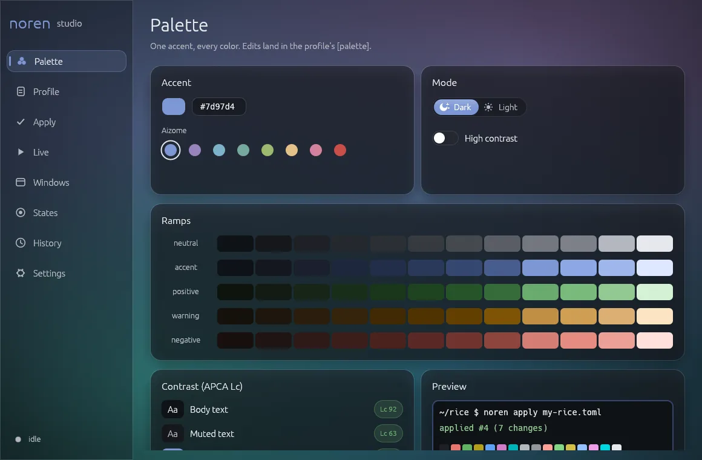

<div align="center">

# noren

**Rice'uj Windowsa jak pulpit na Linuksie i cofnij to jedną komendą.**<br>
Framework w czystym Ruście: panele, widżety pulpitu, nakładki, palety i transakcyjne motywy.

[](LICENSE)
[](#ograniczenia)
[](#budowanie)

[English](README.md) | Polski

</div>

<p align="center"></p>

**noren studio** to miejsce, w którym rice'ujesz. Wybierasz jeden kolor akcentu i patrzysz, jak staje się pełną paletą z tekstem o sprawdzonym kontraście. Widzisz, co się zmieni w Windowsie, Windows Terminal, VS Code i Firefoksie, stosujesz to jako jedną transakcję i cofasz jednym kliknięciem. Reguły okien, przyciemnianie, x-ray, akordy, gorące rogi i poświaty krawędzi trzymasz na żywo, a studio siedzi w zasobniku. Wiersz poleceń `noren` robi to samo ze skryptów i CI.

- **Paleta z jednego koloru.** Rampy OKLCH dla trybu ciemnego i jasnego, z tekstem dociąganym, aż przejdzie kontrast APCA.
- **Bezpieczne zastosowanie i cofanie.** Każdy zapis trafia do dziennika razem z bajtami, które zastępuje. Nieudane apply cofa się samo.
- **Twoje zmiany zostają.** Konfiguracje JSON zachowują komentarze i kolejność kluczy. Rollback nie rusza tego, co zmieniłeś po apply.
- **Profile to pliki TOML.** Trzymasz je w git, porównujesz i udostępniasz.
- **Powierzchnie pulpitu.** Panele, widżety i nakładki jako przezroczyste okna przepuszczające kliknięcia: na warstwie pulpitu, jako AppBar albo nad wszystkim.
- **Tylko Rust.** Licencja MIT, bez webview, bez runtime'u XAML.

## noren studio

| Strona | Co robi |
|---|---|
| Palette | Akcent z presetami Aizome, tryb ciemny lub jasny, wysoki kontrast, rampy na żywo, kontrola APCA, podgląd |
| Profile | Profil jako TOML, sprawdzany w trakcie pisania |
| Apply | Diff, zastosowanie jako jedna transakcja, rollback |
| Live | Trzymanie reguł okien, przyciemniania, x-ray, akordów, gorących rogów i poświat; opcjonalnie od startu |
| Windows | Każde okno i pasujące do niego reguły |
| States | Nazwane stany, za którymi idą ramki i poświaty krawędzi |
| History | Każde zastosowanie, od najnowszego |
| Settings | Angielski albo polski, ograniczenie animacji |

```sh
cargo build --release --features studio
noren-studio                 # startuje na stronie Palette
noren-studio --page live     # palette, profile, apply, live, windows, states, history, settings
```

- Ctrl+K otwiera paletę komend: komendy profilu, skoki do stron, zapis i przełącznik trybu na żywo.
- Zamknięcie okna chowa je do zasobnika; runtime na żywo działa dalej. Menu zasobnika: Otwórz, Trzymaj profil na żywo, Zakończ. Zakończ przywraca wszystkie okna i wychodzi.
- Szklane panele i płynne animacje. Domyślny wygląd to Aizome, własna indygowa paleta noren, a studio przebarwia się według palety profilu w trakcie edycji.
- Przełączenie trybu ciemnego i jasnego rozlewa nowe tło po oknie od przełącznika, a ikony księżyca i słońca się animują.
- Na Windows 11 okno dostaje tło akrylowe.
- Ustawienia są w `%LOCALAPPDATA%\noren\studio.json`.
- CLI nie potrzebuje funkcji `studio`.

## Co zmienia

| Cel | Co się zmienia | Gdzie |
|---|---|---|
| Windows | Kolor akcentu, akcent Start i paska zadań, paski tytułu i ramki, tryb jasny/ciemny | Rejestr `HKCU`, potem broadcast `WM_SETTINGCHANGE` |
| Windows Terminal | Dodaje schemat kolorów i ustawia go jako domyślny | `settings.json`, BOM i komentarze zachowane |
| VS Code | `workbench.colorCustomizations` razem z kolorami ANSI terminala | `settings.json`, komentarze zachowane |
| Firefox | `userChrome.css` i preferencja, która go włącza | Oznaczony blok `noren:begin` / `noren:end` |
| Dowolne okno | Rogi, tło Mica/acrylic, ramka, kolory paska tytułu i tekstu, ciemna ramka, przezroczystość, monitor | Atrybuty DWM na żywo, trzymane przez noren studio albo `noren run` |
| Twój własny UI | Panele, widżety i nakładki zbudowane na noren | `Palette::theme()` |

Eksport do czegokolwiek innego: `noren palette <#akcent> --export terminal|vscode|css|kde|firefox`.

## Szybki start

1. Zbuduj (zobacz [Budowanie](#budowanie)):
   ```sh
   cargo build --release --features studio
   ```
2. Uruchom `noren-studio`. Na **Palette** wybierz akcent; na **Profile** dodaj aplikacje do ostylowania (profil startowy ma Windows Terminal i VS Code).
3. Na **Apply** przejrzyj diff i naciśnij Apply. Jedna transakcja, zapisana w dzienniku.
4. Zmiana zdania? Cofnij na **Apply** przywraca każdy bajt. **History** pokazuje każde zastosowanie.

### Z wiersza poleceń

Te same kroki, dla skryptów i CI. `cargo install --path .` daje `noren` w `PATH`.

1. Podejrzyj paletę:
   ```sh
   noren palette '#7d97d4'
   ```
2. Napisz `my-rice.toml`:
   ```toml
   schema = 1
   name = "my-rice"

   [palette]
   accent = "#7d97d4"
   mode = "dark"            # dark | light
   contrast = "standard"    # standard | high

   [windows]
   accent_on_title_bars = true

   [terminal]
   [vscode]
   ```
3. Zobacz, co się zmieni, i zastosuj:
   ```sh
   noren diff my-rice.toml
   noren apply my-rice.toml
   ```
4. Cofnij:
   ```sh
   noren rollback
   ```

Tabela, której nie podasz, nie jest ruszana. Każdy cel przyjmuje `path = "..."`, żeby wskazać niestandardowy plik konfiguracji. Pełny format jest opisany w [src/rice/profile.rs](src/rice/profile.rs).

## Reguły okien

Tabele `[[window]]` w tym samym profilu przestylowują okna innych aplikacji, dopóki działa `noren run`. Ctrl+C przywraca każde okno do stanu sprzed.

```toml
[[window]]                     # bez pól dopasowania: każde okno
corners = "round"              # default | square | round | round_small

[[window]]
exe = "WindowsTerminal.exe"    # globy, bez wielkości liter: exe, class, title
backdrop = "acrylic"           # auto | none | mica | acrylic | tabbed
border = "state:build"         # podąża za `noren state build ...`

[[window]]
title = "*Visual Studio Code"
border = "accent"              # accent | neutral | positive | warning | negative, ".N" wybiera krok
caption = "neutral.2"
title_text = "#ddd6be"         # też: default, none
dark = true
opacity = 0.95                 # od 0.1 do 1.0
monitor = 2                    # 1 = główny, potem od lewej; przenoszone raz, gdy okno się pojawi
```

Późniejsze reguły nadpisują wcześniejsze pole po polu. `noren windows my-rice.toml` wypisuje każde okno z exe, klasą i tytułem oraz które reguły do niego pasują.

### Ramki w kolorze stanu

Stan to nazwa z wartością: `ok`, `fail`, `warn` albo `busy`. Każdy skrypt może go ustawić:

```sh
cargo build && noren state build ok || noren state build fail
noren state build clear
noren state                    # lista
```

Okna z `border = "state:build"` w ciągu pół sekundy robią się zielone, czerwone, bursztynowe albo w kolorze akcentu, kolorami statusu z palety. Wyczyszczony stan oddaje ramkę systemowi. Stany to zwykłe pliki w `%LOCALAPPDATA%\noren\state`, więc hook gita może zapisać stan bez noren w `PATH`.

### Przyciemnianie poza fokusem i x-ray

```toml
[focus]
dim = 0.35                     # 0.05 do 0.9: jak ciemne robi się wszystko za oknem z fokusem
color = "neutral.1"            # hex albo rola z palety, domyślnie czarny
except = ["mpv.exe"]           # globy exe, które nigdy nie dostają przyciemnienia

[xray]
key = "Ctrl+Alt+Space"         # modyfikatory plus jeden klawisz: A-Z, 0-9, F1-F24, space, tab, esc, `...
opacity = 0.2                  # 0.05 do 0.9, domyślnie 0.2
```

`[focus]` trzyma jedną przepuszczającą kliknięcia warstwę tuż za oknem z fokusem, więc reszta przygasa, a pasek zadań zostaje jasny. Chowa się na pulpicie, przy oknach pełnoekranowych i gdy x-ray jest wciśnięty. `[xray]` robi wszystkie okna przezroczystymi, dopóki trzymasz kombinację, żeby zobaczyć pulpit albo widżet pod nimi; puszczenie oddaje każdemu oknu jego własną przezroczystość, z reguły czy bez. Ostatni klawisz kombinacji jest połykany, modyfikatory nie, a modyfikatory muszą się zgadzać dokładnie: Ctrl+Shift+Alt+Space nie odpala Ctrl+Alt+Space. Oba działają bez reguł `[[window]]` w profilu.

### Komendy, akordy i gorące rogi

```toml
[chords]
leader = "Alt+Space"           # wciśnij, puść, potem wpisz klawisze komendy
timeout = 1.5                  # sekundy na następny klawisz, 0.3 do 10

[corners]
dwell = 0.25                   # ile sekund kursor stoi w rogu, 0 do 2

[[command]]
name = "Terminal"
keys = "t"                     # akord po leaderze; "g s" to dwa klawisze
run = ["wt.exe"]               # program i argumenty

[[command]]
name = "Mark build failed"
state = "build=fail"           # ok | fail | warn | busy | clear

[[command]]
name = "noren on GitHub"
open = "https://github.com/KayZedd/noren"   # URL, plik albo folder

[[command]]
name = "Command palette"
corner = "top-left"            # top-left | top-right | bottom-left | bottom-right
builtin = "palette"
```

Każda `[[command]]` ma unikalną nazwę i dokładnie jedną akcję: `run`, `open`, `state` albo `builtin = "palette"`. Wciśnij i puść leader, potem wpisz klawisze: są połykane, więc aplikacja pod spodem nic nie widzi, zły klawisz albo Esc anuluje, a modyfikatory mogą zostać wciśnięte. Żaden akord nie może być prefiksem innego. Gorący róg odpala raz na wizytę, gdy kursor postoi w jego strefie 2 px; działa per monitor i nic nie robi przy wciśniętym przycisku myszy ani gdy fokus ma aplikacja pełnoekranowa. Paleta to małe okno z wyszukiwaniem rozmytym po wszystkich komendach, z klawiszami czy bez: strzałki przesuwają, Enter uruchamia, Esc albo kliknięcie obok zamyka. W noren studio Ctrl+K otwiera tę samą paletę nad aplikacją, z komendami profilu oraz skokami do stron, zapisem i przełącznikiem trybu na żywo. `noren commands` wypisuje i uruchamia komendy z terminala.

### Poświata krawędzi

```toml
[[glow]]
state = "ci"                   # podąża za `noren state ci ...`; ciemno, gdy stan jest wyczyszczony
edges = ["top"]                # top | bottom | left | right, domyślnie wszystkie cztery
monitor = 1                    # numeracja jak w regułach okien, domyślnie każdy monitor
width = 8                      # piksele przy skali 100%, 2 do 48
opacity = 0.85                 # szczyt, 0.1 do 1
pulse = ["busy", "warn"]       # stany, które oddychają zamiast świecić równo (domyślnie)
settle = 6                     # ok gaśnie po tylu sekundach, domyślnie świeci dalej

[[glow]]
state = "agent"                # `noren state agent warn`, gdy agent czeka na Ciebie
edges = ["bottom"]
```

Cienki pasek światła wzdłuż krawędzi ekranu pokazuje stan bez żadnego okna: zielony, gdy CI przeszło, czerwony, gdy padło, powolny oddech, gdy trwa build albo agent czeka na input. Kolory pochodzą z palety (ok positive, fail negative, warn warning, busy accent). Zmiana przechodzi płynnie, a wyczyszczony stan gaśnie. Światło jest najmocniejsze przy krawędzi, a końce się zwężają. Paski przepuszczają kliknięcia, nigdy nie biorą fokusu i chowają się na monitorze, na którym fokus ma aplikacja pełnoekranowa. Dwie poświaty nie mogą świecić na tej samej krawędzi tego samego monitora.

## FAQ

**Zepsuje mi ustawienia?** Przed zapisem noren zapisuje w `%LOCALAPPDATA%\noren\journal` każdą wartość, którą zaraz nadpisze. Jeśli któryś zapis się nie uda, wykonane już zapisy są cofane. `noren rollback` przywraca poprzednie bajty co do jednego. W teście end-to-end `settings.json` VS Code wrócił identyczny bajt w bajt po apply i rollback.

**Zmieniłem coś ręcznie po apply. Co zrobi rollback?** Przywraca tylko wartości, które dalej zawierają to, co zapisał noren. Resztę wypisuje jako zachowaną. `noren rollback --force` nadpisuje je mimo to.

**Potrzebuje uprawnień administratora?** Nie. Pisze tylko do `HKCU` i do plików w Twoim profilu. Wyjątek to okna uruchomione jako administrator: Windows nie pozwala zwykłemu procesowi ich przestylować, więc `noren run` je pomija, chyba że też działa z podniesionymi uprawnieniami.

**Na czym zbudowany jest interfejs?** noren studio to zwykłe okno aplikacji w egui. Panele, widżety i nakładki używają własnego stosu noren (layout taffy, tiny-skia, cosmic-text) na warstwowych oknach Win32, bo potrzebują alfy per piksel, przepuszczania kliknięć, AppBar i warstwy pulpitu, czego biblioteki okien aplikacji nie obsługują.

**Linux albo macOS?** Silnik palet, logika profili i dziennika oraz cały stos UI działają i są testowane na Linuksie. Cele plikowe też tam działają. Cele rejestru i natywny host są tylko na Windows. Feature `preview` otwiera okno deweloperskie na każdym systemie.

## Jak to działa

### Paleta

`noren::palette` buduje system kolorów z jednego akcentu, w OKLCH (percepcyjna przestrzeń Björna Ottossona):

| Kroki | Rola |
|---|---|
| 1-2 | Tło aplikacji i subtelne tło |
| 3-5 | Tła komponentów: normalne, hover, wciśnięte |
| 6-8 | Ramki i separatory |
| 9-10 | Pełne wypełnienia: przyciski, odznaki |
| 11-12 | Tekst o niskim i wysokim kontraście |

- Neutralne odcienie są zabarwione w stronę akcentu, więc szarości do niego pasują.
- Rampy positive, warning i negative biorą jasność i chromę akcentu, więc żaden kolor statusu nie odstaje.
- Kroki tekstu są przesuwane, aż spełnią progi APCA na tle (Lc 90 dla tekstu, Lc 100 z `contrast = "high"`). Testy sprawdzają 72 odcienie w obu trybach i na obu poziomach kontrastu.
- Kolory spoza sRGB tracą chromę, nigdy jasność ani odcień.
- 16 kolorów ANSI pochodzi z tych samych ramp.

### Transakcje

```
profile.toml ──► changes ──► plan (pomija sloty, które już są równe)
                                │
                     dziennik: Pending + poprzednie bajty   (plik tmp, potem rename)
                                │
                     zapis każdego slotu ── błąd ──► cofnięcie zapisanych slotów
                                │
                     dziennik: Applied ──► WM_SETTINGCHANGE "ImmersiveColorSet"
```

Slot to wartość rejestru albo plik. Rollback porównuje każdy slot z tym, co według dziennika zapisał noren, przywraca zgodne i oznacza transakcję jako `RolledBack`. Dwukrotne apply tego samego profilu nic nie robi.

### Powierzchnie

```
Surface (trait)            jedno przezroczyste okno na jednym monitorze
├── Panel                  auto-hide top bar + popupy, hostuje Widgety
│   └── Widget (trait)     kompaktowy widok w pasku, opcjonalny popup, wiadomości
└── Floating<V: View>      drzewo elementów przypięte do rogu/krawędzi monitora
                           Layer::Desktop (widżety), Normal, Top (nakładki)

Element<M>                 deklaratywne drzewo: row/column/grid/text/svg/painter
layout → Frame             layout taffy, domyślne jak w QML (bez niejawnego kurczenia)
render                     malowanie tiny-skia, hover, przycinanie, przewijanie

host::run                  Win32: okna warstwowe, UpdateLayeredWindow, AppBar,
                           śledzenie monitorów/DPI, wykrywanie pełnego ekranu
host::preview::run         okno winit jako wirtualny monitor (każdy system)
host::sim::Simulator       headless pulpit: kompozycja, routing wejścia, PNG
```

Powierzchnie działają w pikselach logicznych względem swojego monitora. Hosty przeliczają na współrzędne fizyczne przez per-monitor DPI v2. Ta sama `Surface` działa pod wszystkimi trzema hostami, więc większość zachowań jest testowana na Linuksie bez wyświetlacza.

## Budowanie widżetów

Górny panel:

```rust,ignore
use noren::host::{self, Entry, SurfaceOptions};
use noren::{Panel, PanelConfig, Theme};

let mut panel = Panel::new(PanelConfig::default(), Theme::aizome());
panel.add(MyWidget::new()); // impl Widget
host::run(vec![Entry::new(panel, SurfaceOptions::panel())])?;
```

Widżet pulpitu w prawym dolnym rogu, pod wszystkimi oknami:

```rust,ignore
use noren::surface::{Anchor, FloatingConfig, Layer};
use noren::Floating;

let config = FloatingConfig { anchor: Anchor::BottomRight, layer: Layer::Desktop, ..Default::default() };
let clock = Floating::new(Clock::default(), config, Theme::aizome()); // impl View
host::run(vec![Entry::new(clock, SurfaceOptions::default())])?;
```

[examples/pulse.rs](examples/pulse.rs) to kompletny widżet przeniesiony z plazmoidu KDE `systempulse`: pierścienie CPU, RAM i GPU, temperatura i sieć, popup z kartami statystyk i sparkline'ami.

```sh
cargo run --release --example pulse                          # Windows: natywny panel
cargo run --example pulse --features preview -- --preview     # każdy system: okno dev
cargo run --example pulse -- --screenshot pulse.png --popup   # headless PNG
```

Obciążenie GPU pochodzi z liczników wydajności `GPU Engine`, tego samego źródła, którego używa Menedżer zadań. Temperatura pokazuje "n/a", gdy żaden czujnik nie jest dostępny w trybie użytkownika.

Tekst używa rodzin czcionek z motywu i spada na czcionki systemowe. Żadne czcionki nie są dołączone. Żeby dołączyć własną, wywołaj `TextSystem::load_fonts(path)` i sprawdź jej licencję.

## Wiersz poleceń

Wszystko, co robi studio, dla skryptów, CI i klawiatury.

```sh
noren palette <#akcent> [--light] [--high]           # próbki w terminalu
noren palette <#akcent> --export terminal            # też: vscode, css, kde, firefox
noren diff <profile.toml>                            # co zmieni apply
noren apply <profile.toml>                           # zastosuj jako jedną transakcję
noren rollback [--force]                             # cofnij najnowszą transakcję
noren log                                            # lista transakcji
noren run <profile.toml>                             # trzymaj reguły, [focus], [xray], akordy, rogi, poświaty do Ctrl+C
noren windows [<profile.toml>]                       # okna i pasujące reguły
noren state [<nazwa> <ok|fail|warn|busy|clear>]      # ustaw albo wypisz stany
noren commands <profile.toml> [<nazwa>]              # lista [[command]] albo uruchom jedną
noren <komenda> --journal <katalog>                  # dziennik w innym miejscu
noren <komenda> --state-dir <katalog>                # stany w innym miejscu
```

## Roadmapa

Zrobione:
- [x] Rice jako wersjonowany plik TOML
- [x] Transakcyjne apply, diff i rollback
- [x] Jedna paleta wypychana do wszystkich celów
- [x] Deklaratywne reguły okien: rogi, Mica, przezroczystość, kolor ramki, monitor
- [x] Kolor ramki okna ze stanu (build padł, git brudny) przez `noren state <nazwa> <ok|fail|warn|busy>`
- [x] Przyciemnianie poza fokusem i klawisz x-ray
- [x] noren studio: aplikacja do zarządzania z ikoną w zasobniku

W planach:
- [ ] Każdy program wypisujący JSON jest widżetem
- [ ] Widżety przyklejone do okien innych aplikacji
- [ ] Żywe lustra miniatur DWM
- [ ] Układy per aplikacja na pierwszym planie i per pulpit wirtualny
- [ ] Położenie widżetów i kolor tekstu dobierane z tapety
- [ ] Motyw zależny od pory dnia i wschodu słońca
- [x] Poświata krawędzi ekranu jako status
- [x] Akordy leader-key, paleta komend, gorące rogi
- [ ] Zamiennik Alt+Tab z żywymi miniaturami
- [ ] Widżet multimediów z motywem z okładki
- [ ] Przestylowane powiadomienia
- [ ] Karta rice'a do udostępnienia jako PNG

## Ograniczenia

- **Jeszcze nie uruchomione na prawdziwym Windowsie.** Host Win32, zapisy do rejestru i broadcast akcentu są sprawdzone przez `cargo clippy --target x86_64-pc-windows-msvc` i testy jednostkowe, nie na żywym pulpicie. To samo dotyczy zasobnika i tła akrylowego studia, akordów, gorących rogów, okna palety i poświat krawędzi. Zgłoszenia mile widziane.
- Zaokrąglone rogi oraz kolory ramki, paska tytułu i tekstu wymagają Windows 11. Tła wymagają Windows 11 22H2 i prześwitują tylko tam, gdzie aplikacja maluje przezroczyste tło; większość klasycznych aplikacji Win32 je zamalowuje.
- Okna, które już są warstwowe (same rysują przezroczystość), zachowują swoją przezroczystość pod x-ray i regułami `opacity`. Kombinacja z samych modyfikatorów z Win, np. `Ctrl+Win`, może po puszczeniu otworzyć menu Start; dodaj klawisz.
- Poświaty to okna topmost, ale pasek zadań i tak może rysować się nad poświatą na swojej krawędzi.
- `noren run` musi działać, żeby reguły okien się trzymały. Zabity bez Ctrl+C zostawia okna w swoim stylu, dopóki się nie zamkną.
- Firefox ignoruje `userChrome.css` do restartu. VS Code i Windows Terminal przeładowują się same.
- Rollback usuwa pliki utworzone przez noren, ale zostawia pusty folder `chrome` Firefoksa.
- Windows nie dokumentuje wartości rejestru akcentu. Aktualizacja funkcji może je zmienić.
- Projekt niezwiązany z Microsoftem ani KDE.

## Budowanie

Rust 1.95+ (edycja 2024):

```bash
git clone https://github.com/KayZedd/noren.git
cd noren
cargo test --all-targets
cargo build --release
```

Plik wykonywalny to `target/release/noren` (`noren.exe` na Windows).

Sprawdzenia, które musi przejść każda zmiana:

```sh
cargo test --all-targets                                       # testy bramkowe, < 1 s
cargo clippy --all-targets --features preview,studio
cargo clippy --target x86_64-pc-windows-msvc --all-targets     # host Win32 z Linuksa
cargo clippy --target x86_64-pc-windows-msvc --all-targets --features studio
```

Testy renderowania tekstu działają tylko z zainstalowanym Noto Sans albo DejaVu Sans. Bez nich przechodzą trywialnie.

Struktura:

| Ścieżka | Rola |
|---|---|
| [src/palette/](src/palette/) | OKLCH, APCA, rampy, eksport do Terminala, VS Code, CSS, KDE, Firefoksa, akcentu Windows |
| [src/rice/](src/rice/) | Profile, dziennik, apply i rollback, merge JSONC, magazyn rejestru i plików |
| [src/shell/](src/shell/) | Reguły okien, stany, przyciemnianie, x-ray, komendy (akordy, gorące rogi), poświaty krawędzi i runtime Win32, który je trzyma |
| [src/bin/noren.rs](src/bin/noren.rs) | Wiersz poleceń |
| [src/studio/](src/studio/), [src/bin/noren-studio.rs](src/bin/noren-studio.rs) | noren studio: aplikacja egui, szklany motyw, zasobnik, paleta komend |
| [src/surface.rs](src/surface.rs), [src/panel/](src/panel/), [src/widget.rs](src/widget.rs) | Powierzchnie, panel, trait widżetu |
| [src/element.rs](src/element.rs), [src/layout.rs](src/layout.rs), [src/render.rs](src/render.rs) | Drzewo elementów, layout, malowanie |
| [src/host/](src/host/) | Host Win32, okno podglądu, headless symulator |
| [src/theme.rs](src/theme.rs), [src/text.rs](src/text.rs) | Motywy i tekst |
| [examples/pulse.rs](examples/pulse.rs) | Widżet monitora systemu |

## Podziękowania

- [OKLab](https://bottosson.github.io/posts/oklab/), Björn Ottosson: przestrzeń kolorów.
- [APCA](https://github.com/Myndex/apca-w3), Andrew Somers: model kontrastu.
- [Radix Colors](https://www.radix-ui.com/colors): role dwunastu kroków rampy.
- [tiny-skia](https://github.com/linebender/tiny-skia), [cosmic-text](https://github.com/pop-os/cosmic-text), [taffy](https://github.com/DioxusLabs/taffy), [resvg](https://github.com/linebender/resvg), [windows-rs](https://github.com/microsoft/windows-rs), [jsonc-parser](https://github.com/dprint/jsonc-parser).

## Wesprzyj projekt

⭐ pomaga innym znaleźć noren. Zgłoszenia błędów z prawdziwych maszyn z Windowsem pomagają jeszcze bardziej.

## Licencja

[MIT](LICENSE). Windows jest znakiem towarowym Microsoft Corporation.
